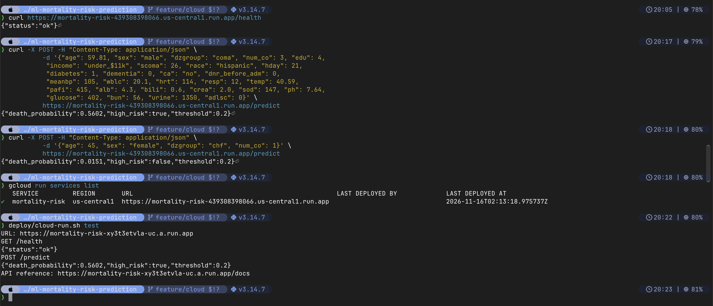

# MidProject | Machine Learning for Mortality Risk Prediction

Machine-learning model that predicts the **risk of in-hospital death** for critically ill adult patients, using clinical data collected around **day 3 of hospitalization** (SUPPORT2 dataset).

---

## 1. Problem description

### What we predict
A binary outcome, **`hospdead`**: did the patient die during the hospital stay?

| Value | Meaning | Count | Share |
|---|---|---|---|
| `0` | Discharged alive | 6,745 | 74.1% |
| `1` | Died in hospital | 2,360 | 25.9% |

The model outputs a **probability of death** (0–1), not just a yes/no label, so the score can be used to rank patients by risk.

### Who benefits and how the model is used
- **ICU / ward clinicians**: an early, objective risk score that helps flag patients who are deteriorating and need closer monitoring or an escalation of care.
- **Palliative-care teams**: a prompt to start goals-of-care and advance-directive conversations early, rather than in the last hours.
- **Hospital managers**: help with planning beds, staff and ICU capacity.

Intended use: the model is a **decision-support tool**. A clinician sends a patient's day-3 variables to a prediction service and receives a risk probability. The model does **not** replace clinical judgement.

### Why this problem matters
Doctors often misjudge how likely a seriously ill patient is to survive. The original SUPPORT study was designed to improve end-of-life care because doctors' estimates and patients' wishes often did not match the care the patients received. An accurate, calibrated mortality score helps clinicians and families make better-informed decisions, put scarce ICU resources where they are needed, and avoid aggressive treatment that the patient does not want.

### Evaluation metric
The target is **imbalanced** (~26% positive), so accuracy is misleading: a model that always predicts "survives" is 74% accurate and useless.

- **Primary metric: PR-AUC (Average Precision).** This measures how well the model ranks the minority class (deaths).
- **Secondary metrics:**
  - **Recall** for deaths at the chosen threshold, because missing a high-risk patient (a false negative) is the costlier error.
  - **Precision** at that threshold, to keep the false-alarm rate acceptable.
  - **ROC-AUC**, which makes results easy to compare with the medical literature.
  - **Brier score / calibration curve**, because the output is used as a probability.

---

## 2. Dataset

**SUPPORT2**: *Study to Understand Prognoses and Preferences for Outcomes and Risks of Treatments*. It covers 9,105 critically ill adults from 5 US medical centers (1989–1991 and 1992–1994).

- UCI Machine Learning Repository: <https://archive.ics.uci.edu/dataset/880/support2>
- Kaggle (CSV): <https://www.kaggle.com/datasets/joebeachcapital/support2>

The dataset is committed at `data/support2.csv` (~3 MB, 9,105 rows × 47 variables plus a row index).

### Download (if `data/support2.csv` is missing)
```bash
# Option A: Kaggle CLI (needs ~/.kaggle/kaggle.json)
kaggle datasets download -d joebeachcapital/support2 -p data/ --unzip

# Option B: UCI via Python
pip install ucimlrepo
python -c "from ucimlrepo import fetch_ucirepo; d=fetch_ucirepo(id=880); \
d.data.original.to_csv('data/support2.csv', index=False)"
```

### Feature groups
| Group | Columns |
|---|---|
| Demographics | `age`, `sex`, `race`, `edu`, `income` |
| Diagnosis / comorbidity | `dzgroup`, `dzclass`, `num.co`, `diabetes`, `dementia`, `ca` |
| Day-3 physiology | `meanbp`, `wblc`, `hrt`, `resp`, `temp`, `pafi`, `alb`, `bili`, `crea`, `sod`, `ph`, `glucose`, `bun`, `urine`, `scoma` |
| Functional status | `adlp`, `adls`, `adlsc` |
| Care context | `hday`, `dnr` (only "DNR before admission" is used) |
| **Excluded (leakage)** | `death`, `d.time`, `slos`, `sfdm2`, `charges`, `totcst`, `totmcst`, `aps`, `sps`, `surv2m`, `surv6m`, `prg2m`, `prg6m`, `dnrday`, `avtisst` |

### Missing data
| Column | Missing | Column | Missing |
|---|---|---|---|
| `adlp` | 62% | `adls` | 32% |
| `urine` | 53% | `bili` | 29% |
| `glucose` | 49% | `pafi` | 26% |
| `bun` | 48% | `ph` | 25% |
| `alb` | 37% | `edu` | 18% |
| `income` | 33% | `wblc`, `crea`, `race`, `dnr` | < 3% |

How it is handled (`src/ml_mortality_risk_prediction/features.py`, the same code for training and prediction):
- **Lab values** (`alb`, `pafi`, `bili`, `crea`, `bun`, `wblc`, `urine`): filled with the normal values recommended by the SUPPORT authors, because a test that wasn't ordered was usually judged normal. A `*_missing` flag is added for `alb`, `pafi`, `bili`, `bun` and `urine`.
- **`income`, `race`:** missing values become their own `unknown` category.
- **Other numeric columns** (`edu`, `ph`, `glucose`, ...): filled with the median learned from the training data (saved in the model artifact).
- **`adlp`, `adls`:** not used. `adlsc`, their imputed combination, is used instead.

---

## 3. Project structure
```
.
├── data/
│   └── support2.csv
├── notebook/
│   └── notebook.ipynb            # data prep, EDA, feature importance, model selection & tuning
├── models/
│   └── model.bin                 # trained artifact (created by `uv run train`)
├── src/ml_mortality_risk_prediction/
│   ├── features.py               # cleaning shared by training and inference
│   ├── train.py                  # trains the final model and saves the artifact
│   ├── predict.py                # loads the model, runs inference
│   └── serve.py                  # FastAPI web service (+ Scalar API reference)
├── openapi.json                  # exported OpenAPI spec of the service
├── Dockerfile / .dockerignore    # container image for the web service
├── deploy/
│   ├── cloud-run.sh              # setup / deploy / test / teardown on Google Cloud Run
│   └── README.md                 # cloud deployment guide with screenshots
├── images/                       # screenshots of the cloud deployment
├── .gcloudignore                 # files uploaded to Cloud Build
├── pyproject.toml / uv.lock
└── README.md
```

## 4. How to run

Requirements: [uv](https://docs.astral.sh/uv/) (it installs Python 3.15 and every dependency).

```bash
git clone https://github.com/iofabela/ml-mortality-risk-prediction.git
cd ml-mortality-risk-prediction
uv sync                       # create .venv and install dependencies
```

### Train the model
```bash
uv run train                  # writes models/model.bin
```
It trains the tuned XGBoost (`eta=0.05`, `max_depth=4`, `min_child_weight=30`, 301 rounds), picks the decision threshold on the validation set (recall ≥ 0.80), retrains on train + validation and reports the test scores:
```
validation  PR-AUC 0.645 | ROC AUC 0.822 | @0.20: precision 0.452, recall 0.814
test        PR-AUC 0.624 | ROC AUC 0.813 | @0.20: precision 0.466, recall 0.797
```

### Predict from the command line
```bash
uv run predict                # scores a built-in example patient
uv run predict patient.json   # scores a patient from a JSON file
```

### Run the web service
```bash
uv run serve                  # http://localhost:9696
```

| Endpoint | Description |
|---|---|
| `GET /health` | Simple `200 OK` check: `{"status": "ok"}` |
| `POST /predict` | Accepts one patient as JSON and returns the prediction |
| `GET /docs` | Interactive API reference ([Scalar](https://scalar.com)) |

Example request (a real patient from the test set who died in hospital):
```bash
curl -X POST -H "Content-Type: application/json" \
     -d '{"age": 59.81, "sex": "male", "dzgroup": "coma", "num_co": 3, "edu": 4,
          "income": "under_$11k", "scoma": 26, "race": "hispanic", "hday": 21,
          "diabetes": 1, "dementia": 0, "ca": "no", "dnr_before_adm": 0,
          "meanbp": 105, "wblc": 20.1, "hrt": 114, "resp": 12, "temp": 40.59,
          "pafi": 415, "alb": 4.3, "bili": 0.6, "crea": 2.0, "sod": 147, "ph": 7.64,
          "glucose": 402, "bun": 56, "urine": 1350, "adlsc": 0}' \
     http://localhost:9696/predict
```
Response:
```json
{"death_probability": 0.5602, "high_risk": true, "threshold": 0.2}
```

Only `age`, `sex`, `dzgroup` and `num_co` are required. Any lab value you leave out (or send as `null`) is filled the same way as in training: with the SUPPORT normal value plus a missing flag, or with the training median.
```bash
curl -X POST -H "Content-Type: application/json" \
     -d '{"age": 45, "sex": "female", "dzgroup": "chf", "num_co": 1}' \
     http://localhost:9696/predict
# {"death_probability": 0.0151, "high_risk": false, "threshold": 0.2}
```
Invalid input (an unknown `dzgroup`, an out-of-range value, ...) returns `422` with the reason.

### Run with Docker
The build has two stages. The first installs the locked dependencies (CPU only, without xgboost's GPU library) and trains the model. The final image keeps only the virtual environment, the code and `models/model.bin` (~180 MB compressed, ~730 MB on disk).
```bash
docker build -t mortality-risk .
docker run -it --rm -p 9696:9696 mortality-risk
```
The service is then available at http://localhost:9696. The `curl` examples above work unchanged:
```bash
curl http://localhost:9696/health
# {"status":"ok"}
```
Clean up when you are done (`--rm` already removes the container):
```bash
docker rmi mortality-risk          # delete the image
docker builder prune -f            # optional: delete ALL build cache (for every project)
```

### Scalar tooling
- **API reference:** open http://localhost:9696/docs while the service is running.
- **Scalar CLI:** validate the exported OpenAPI spec, or regenerate it after changing the API:
  ```bash
  curl -s http://localhost:9696/openapi.json > openapi.json
  npx -y @scalar/cli@latest document validate openapi.json
  ```

### Notebook
```bash
uv run jupyter notebook notebook/notebook.ipynb
```

---

## 5. Cloud deployment (Google Cloud Run)

The service was deployed to **[Google Cloud Run](https://cloud.google.com/run)** and tested live, then torn down to avoid costs. Cloud Build builds the same `Dockerfile` (including model training), and Cloud Run serves it on a public HTTPS URL that scales to zero when idle.

**Full step-by-step guide, cost breakdown and screenshots: [`deploy/README.md`](deploy/README.md)**

### Results
| Check | Result |
|---|---|
| URL (while deployed) | `https://mortality-risk-439308398066.us-central1.run.app` |
| `GET /health` | `{"status":"ok"}`, 200 OK in ~115 ms |
| `POST /predict` (example patient) | `{"death_probability":0.5602,"high_risk":true,"threshold":0.2}`, the same as locally |
| Model trained in Cloud Build | test PR-AUC 0.624, ROC AUC 0.813 (same as locally) |
| Image in Artifact Registry | 186 MB |
| Cost | **$0** (free tier); everything deleted afterwards |




### Quick reference
```bash
gcloud config set billing/quota_project <PROJECT_ID>   # avoids 429 errors on gcloud's shared quota
BUDGET=1USD deploy/cloud-run.sh setup    # APIs, IAM, budget alert (use your account currency, e.g. 20MXN)
deploy/cloud-run.sh deploy               # build + deploy (~4 min)
deploy/cloud-run.sh test                 # /health and /predict on the live URL
deploy/cloud-run.sh teardown             # delete service, images and source bucket
```
