# MidProject | Machine Learning for Mortality Risk Prediction

Machine-learning model that predicts the **risk of in-hospital death** for critically ill adult patients, using clinical data collected around **day 3 of hospitalization** (SUPPORT2 dataset). It is served as a REST API, packaged with Docker, and was deployed to Google Cloud Run.



| | |
|---|---|
| **Task** | Binary classification: `hospdead` (died in hospital) |
| **Model** | XGBoost (`eta=0.05`, `max_depth=4`, `min_child_weight=30`, 301 rounds) |
| **Test score** | PR-AUC **0.624** · ROC AUC **0.813** · recall 0.797 / precision 0.466 at threshold 0.20 |
| **Serving** | FastAPI (`POST /predict`, `GET /health`, Scalar docs at `/docs`) → Docker → Cloud Run |

**Contents:**
1. [Problem statement](#1-problem-statement)
2. [Dataset](#2-dataset)
3. [EDA summary](#3-eda-summary)
4. [Modeling approach & metrics](#4-modeling-approach--metrics)
5. [Tech stack](#5-tech-stack)
6. [How to run (locally and with Docker)](#6-how-to-run)
7. [API usage](#7-api-usage)
8. [Cloud deployment](#8-cloud-deployment-google-cloud-run)
9. [Project structure](#9-project-structure)
10. [Known limitations & next steps](#10-known-limitations--next-steps)

---

## 1. Problem statement

**What we predict:** whether a critically ill patient will **die during the hospital stay** (`hospdead`). The model returns a **probability** (0–1), so patients can be ranked by risk, plus a `high_risk` flag.

| Value | Meaning | Count | Share |
|---|---|---|---|
| `0` | Discharged alive | 6,745 | 74.1% |
| `1` | Died in hospital | 2,360 | 25.9% |

**Who benefits:**
- **ICU / ward clinicians**: an early, objective risk score that flags patients who need closer monitoring or an escalation of care.
- **Palliative-care teams**: a prompt to start goals-of-care conversations early, rather than in the last hours.
- **Hospital managers**: input for planning beds, staff and ICU capacity.

**How it is used:** as a **decision-support tool**. A clinician sends a patient's day-3 variables to the service and gets back a risk probability. It does **not** replace clinical judgement.

**Why it matters:** doctors often misjudge how likely a seriously ill patient is to survive. The SUPPORT study was created because doctors' estimates and patients' wishes often did not match the care patients received. A reliable risk score helps clinicians and families make informed decisions, directs scarce ICU resources where they are needed, and helps avoid aggressive treatment the patient does not want.

---

## 2. Dataset

**SUPPORT2** (*Study to Understand Prognoses and Preferences for Outcomes and Risks of Treatments*): 9,105 critically ill adults from 5 US medical centers (1989–1991 and 1992–1994).

- UCI Machine Learning Repository: <https://archive.ics.uci.edu/dataset/880/support2>
- Kaggle (CSV): <https://www.kaggle.com/datasets/joebeachcapital/support2>

The dataset is committed at `data/support2.csv` (~3 MB, 9,105 rows × 47 variables plus a row index). If it is missing:
```bash
# Option A: Kaggle CLI (needs ~/.kaggle/kaggle.json)
kaggle datasets download -d joebeachcapital/support2 -p data/ --unzip

# Option B: UCI via Python
pip install ucimlrepo
python -c "from ucimlrepo import fetch_ucirepo; d=fetch_ucirepo(id=880); \
d.data.original.to_csv('data/support2.csv', index=False)"
```

### Feature groups
| Group | Columns |
|---|---|
| Demographics | `age`, `sex`, `race`, `edu`, `income` |
| Diagnosis / comorbidity | `dzgroup`, `dzclass`, `num.co`, `diabetes`, `dementia`, `ca` |
| Day-3 physiology | `meanbp`, `wblc`, `hrt`, `resp`, `temp`, `pafi`, `alb`, `bili`, `crea`, `sod`, `ph`, `glucose`, `bun`, `urine`, `scoma` |
| Functional status | `adlsc` (`adlp` and `adls` are replaced by this imputed combination) |
| Care context | `hday`, `dnr` (only "DNR before admission" is used) |
| **Excluded (leakage)** | `death`, `d.time`, `slos`, `sfdm2`, `charges`, `totcst`, `totmcst`, `aps`, `sps`, `surv2m`, `surv6m`, `prg2m`, `prg6m`, `dnrday`, `avtisst` |

The excluded columns describe the outcome itself (`death`, `d.time`, `sfdm2`), information only known after day 3 (stay length, costs, `avtisst` averaged over days 3–25, `dnrday`), or published prognosis scores (`aps`, `sps`, `surv*`, `prg*`) that are not available as raw inputs at prediction time.

### Missing data
| Column | Missing | Column | Missing |
|---|---|---|---|
| `adlp` | 62% | `adls` | 32% |
| `urine` | 53% | `bili` | 29% |
| `glucose` | 49% | `pafi` | 26% |
| `bun` | 48% | `ph` | 25% |
| `alb` | 37% | `edu` | 18% |
| `income` | 33% | `wblc`, `crea`, `race`, `dnr` | < 3% |

`src/ml_mortality_risk_prediction/features.py` handles missing values with the same code for training and prediction:
- **Lab values** (`alb`, `pafi`, `bili`, `crea`, `bun`, `wblc`, `urine`) are filled with the normal values recommended by the SUPPORT authors, because a test that wasn't ordered was usually judged normal. A `*_missing` flag is added for `alb`, `pafi`, `bili`, `bun` and `urine`.
- **`income`, `race`**: a missing value becomes its own `unknown` category.
- **Other numeric columns** (`edu`, `ph`, `glucose`, …) are filled with the training median, which is saved in the model artifact.
- **Impossible values** (`alb > 10`, `glucose < 10`) are treated as data-entry errors and set to missing.

---

## 3. EDA summary

Full analysis: [`notebook/notebook.ipynb`](notebook/notebook.ipynb) (data preparation, EDA, feature importance, model selection).

- **Imbalanced target:** 25.9% of patients die. Accuracy is misleading (always predicting "survives" scores 74%), so splits are stratified and the main metric is PR-AUC.
- **Diagnosis matters most among categorical features.** `dzgroup` / `dzclass` have the highest mutual information and the largest risk ratios: ARF/MOSF and coma patients die far more often than CHF or COPD patients.
- **Coma score is the strongest numerical signal.** `scoma` has the highest correlation with death: patients with `scoma > 40` die much more often than those with `scoma = 0`.
- **Missingness is informative.** Missing labs usually mean "not ordered, judged normal", so they are filled with normal values and kept visible through `*_missing` flags. `ph` and `glucose` are missing together with `pafi` and `bun` (ρ ≈ 0.99 and 0.96), so they get no extra flag.
- **No redundant numeric pairs.** No two numerical features have |r| > 0.9, so none had to be dropped.
- **Zeros are real.** `hrt`, `meanbp` and `resp` equal to 0 record a cardiac or respiratory arrest, so they are kept rather than treated as errors.
- **The model agrees with the EDA.** XGBoost's feature importance (gain) ranks `scoma`, the diagnosis and `hday` at the top.

---

## 4. Modeling approach & metrics

**Validation framework:** 60% train / 20% validation / 20% test, stratified, `random_state=1`. Features are one-hot encoded with `DictVectorizer`; logistic regression additionally uses `log1p` on skewed columns.

**Metrics:**
- **PR-AUC (average precision)** is the primary metric. It measures how well the model finds the minority class, and its random baseline is the positive rate (≈ 0.26).
- **ROC AUC** makes the results comparable with the medical literature.
- **Recall and precision at the decision threshold.** Missing a high-risk patient is the costlier error, so the threshold is the highest one that keeps **recall ≥ 0.80** on validation. That threshold is **0.20**.

**Models compared:** a baseline and three tuned models. Hyperparameters were tuned on validation, with stratified k-fold CV for logistic regression's `C`.

| Model | Tuned | Validation PR-AUC |
|---|---|---|
| Logistic regression (baseline) | `C` | 0.625 |
| Decision tree | `max_depth`, `min_samples_leaf` | 0.570 |
| Random forest | `n_estimators`, `max_depth`, `min_samples_leaf` | 0.628 |
| **XGBoost** (selected) | `eta`, `max_depth`, `min_child_weight`, rounds | **0.645** (ROC AUC 0.822) |

**Final model:** XGBoost with `eta=0.05`, `max_depth=4`, `min_child_weight=30` and 301 rounds, a shallow and heavily regularized model. It was retrained on train + validation and evaluated **once** on the test set:

| | PR-AUC | ROC AUC | Precision @0.20 | Recall @0.20 |
|---|---|---|---|---|
| Validation | 0.645 | 0.822 | 0.452 | 0.814 |
| **Test** | **0.624** | **0.813** | **0.466** | **0.797** |
| SUPPORT published model (benchmark, test) | 0.644 | 0.821 | | |

The test score is close to the validation score, so tuning did not overfit the validation set much. The SUPPORT benchmark is a published model built on the APS physiology score. Getting within 0.02 PR-AUC of it from the raw day-3 variables is a reasonable result. At recall 0.80, about one in two flagged patients actually dies.

---

## 5. Tech stack

| Area | Tools |
|---|---|
| Language & environment | Python 3.15, [uv](https://docs.astral.sh/uv/) (dependencies locked in `uv.lock`) |
| Data & EDA | pandas, NumPy, Jupyter, matplotlib, seaborn |
| Modeling | scikit-learn (`DictVectorizer`, logistic regression, decision tree, random forest, metrics), XGBoost |
| Serving | FastAPI, Pydantic (input validation), Uvicorn |
| API docs | [Scalar](https://scalar.com) API reference (`/docs`), Scalar CLI (OpenAPI validation) |
| Containerization | Docker (multi-stage build, model trained during the build) |
| Cloud | Google Cloud Run, Cloud Build, Artifact Registry, gcloud CLI |
| Diagram | [diagram-design](https://github.com/cathrynlavery/diagram-design) (`images/architecture.html` → `.svg`) |

---

## 6. How to run

### Locally
Requirements: [uv](https://docs.astral.sh/uv/), which installs Python 3.15 and every dependency.

```bash
git clone https://github.com/iofabela/ml-mortality-risk-prediction.git
cd ml-mortality-risk-prediction
uv sync                       # create .venv and install dependencies

uv run train                  # train the final model -> models/model.bin
uv run predict                # score a built-in example patient
uv run predict patient.json   # score a patient from a JSON file
uv run serve                  # start the API on http://localhost:9696

uv run jupyter notebook notebook/notebook.ipynb   # open the analysis notebook
```
`uv run train` prints:
```
validation  PR-AUC 0.645 | ROC AUC 0.822 | @0.20: precision 0.452, recall 0.814
test        PR-AUC 0.624 | ROC AUC 0.813 | @0.20: precision 0.466, recall 0.797
```

### With Docker
The build has two stages. The first installs the locked dependencies (CPU only, without xgboost's GPU library) and trains the model. The final image keeps only the virtual environment, the code and `models/model.bin` (~180 MB compressed).
```bash
docker build -t mortality-risk .
docker run -it --rm -p 9696:9696 mortality-risk     # http://localhost:9696

docker rmi mortality-risk                           # clean up when done
```

---

## 7. API usage

| Endpoint | Description |
|---|---|
| `GET /health` | Liveness check: `{"status": "ok"}` |
| `POST /predict` | Takes one patient as JSON and returns the prediction |
| `GET /docs` | Interactive API reference ([Scalar](https://scalar.com)) |

Example request with a real patient from the test set, who died in hospital:
```bash
curl -X POST -H "Content-Type: application/json" \
     -d '{"age": 59.81, "sex": "male", "dzgroup": "coma", "num_co": 3, "edu": 4,
          "income": "under_$11k", "scoma": 26, "race": "hispanic", "hday": 21,
          "diabetes": 1, "dementia": 0, "ca": "no", "dnr_before_adm": 0,
          "meanbp": 105, "wblc": 20.1, "hrt": 114, "resp": 12, "temp": 40.59,
          "pafi": 415, "alb": 4.3, "bili": 0.6, "crea": 2.0, "sod": 147, "ph": 7.64,
          "glucose": 402, "bun": 56, "urine": 1350, "adlsc": 0}' \
     http://localhost:9696/predict
```
```json
{"death_probability": 0.5602, "high_risk": true, "threshold": 0.2}
```

Only `age`, `sex`, `dzgroup` and `num_co` are required. Any lab value you leave out, or send as `null`, is filled the same way as in training:
```bash
curl -X POST -H "Content-Type: application/json" \
     -d '{"age": 45, "sex": "female", "dzgroup": "chf", "num_co": 1}' \
     http://localhost:9696/predict
# {"death_probability": 0.0151, "high_risk": false, "threshold": 0.2}
```
Invalid input, such as an unknown `dzgroup` or an out-of-range value, returns `422` with the reason.

The exported OpenAPI spec is in `openapi.json`. To regenerate and validate it after changing the API:
```bash
curl -s http://localhost:9696/openapi.json > openapi.json
npx -y @scalar/cli@latest document validate openapi.json
```

---

## 8. Cloud deployment (Google Cloud Run)

The service was deployed to **[Google Cloud Run](https://cloud.google.com/run)**, tested live, then torn down to avoid costs. Cloud Build builds the same `Dockerfile` (including model training), and Cloud Run serves it on a public HTTPS URL that scales to zero when idle.

**Step-by-step guide, cost breakdown and screenshots: [`deploy/README.md`](deploy/README.md)**

| Check | Result |
|---|---|
| URL (while deployed) | `https://mortality-risk-439308398066.us-central1.run.app` |
| `GET /health` | `{"status":"ok"}`, 200 OK in ~115 ms |
| `POST /predict` (example patient) | `death_probability 0.5602`, the same as locally |
| Model trained in Cloud Build | test PR-AUC 0.624, ROC AUC 0.813 (the same as locally) |
| Cost | **$0** (free tier); everything was deleted afterwards |


```bash
BUDGET=1USD deploy/cloud-run.sh setup    # APIs, IAM, budget alert (use your account currency)
deploy/cloud-run.sh deploy               # build + deploy (~4 min)
deploy/cloud-run.sh test                 # /health and /predict on the live URL
deploy/cloud-run.sh teardown             # delete the service, images and source bucket
```

---

## 9. Project structure
```
.
├── data/support2.csv                 # dataset
├── notebook/notebook.ipynb           # data prep, EDA, feature importance, model selection & tuning
├── src/ml_mortality_risk_prediction/
│   ├── features.py                   # cleaning shared by training and inference
│   ├── train.py                      # trains the final model and saves the artifact
│   ├── predict.py                    # loads the model, runs inference
│   └── serve.py                      # FastAPI web service (+ Scalar API reference)
├── models/model.bin                  # trained artifact (created by `uv run train`)
├── openapi.json                      # exported OpenAPI spec
├── Dockerfile / .dockerignore        # container image for the web service
├── deploy/
│   ├── cloud-run.sh                  # setup / deploy / test / teardown on Google Cloud Run
│   └── README.md                     # cloud deployment guide with screenshots
├── .gcloudignore                     # files uploaded to Cloud Build
├── images/                           # architecture diagram (+ source .html) and deployment screenshots
├── pyproject.toml / uv.lock
└── README.md
```

---

## 10. Known limitations & next steps

**Limitations**
- **Old, US-only data.** SUPPORT2 was collected in 1989–1994 at 5 US hospitals. Clinical practice has changed since then, so the model would need external validation and recalibration before any real use.
- **Below the published benchmark.** Test PR-AUC is 0.624, against 0.644 for the SUPPORT model, which uses the APS physiology score.
- **Many false alarms.** At recall 0.80, precision is about 0.47, so roughly every second flagged patient survives. That is acceptable for a "look closer" prompt, not for automated decisions.
- **Calibration isn't checked.** The service returns raw XGBoost probabilities. `train.py` reports no calibration curve or Brier score.
- **"Missing = normal" assumption.** Unordered labs are filled with normal values. That matches the SUPPORT authors' advice, but it may not hold in another hospital.
- **Demo-grade API.** There is no authentication, rate limiting or request logging, and it is not a certified medical device.

**Next steps**
- Calibrate the probabilities (isotonic or Platt) and report a calibration curve and Brier score in `train.py`.
- Add per-patient explanations (SHAP values) to the `/predict` response.
- Add tests (`features.clean`, the API contract) and a CI workflow that builds the Docker image.
- Validate on a newer, external ICU dataset (for example MIMIC-IV).
- Add authentication and monitoring (input drift, prediction distribution) to the deployed service.
