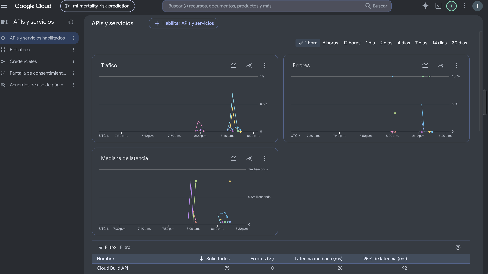
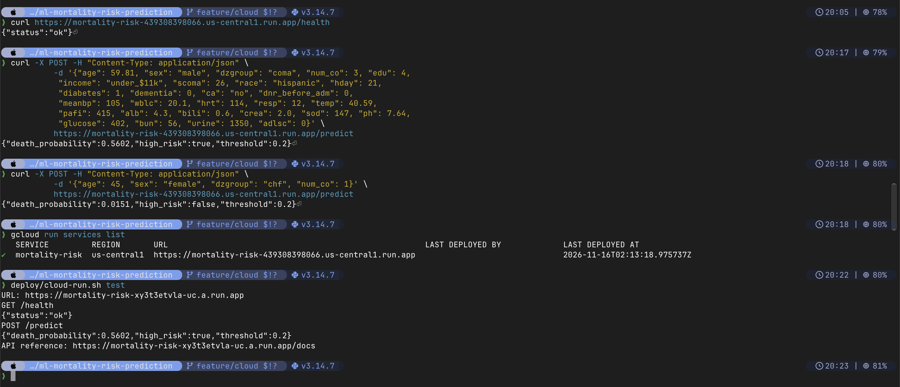
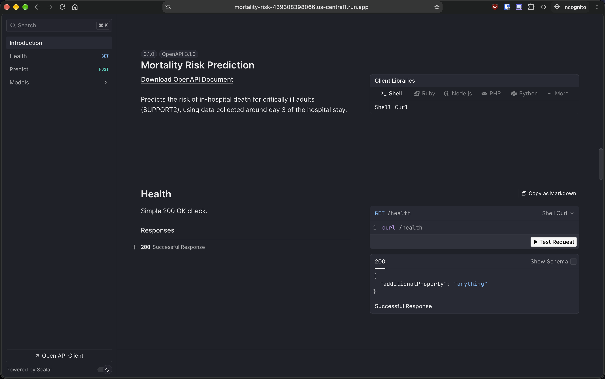
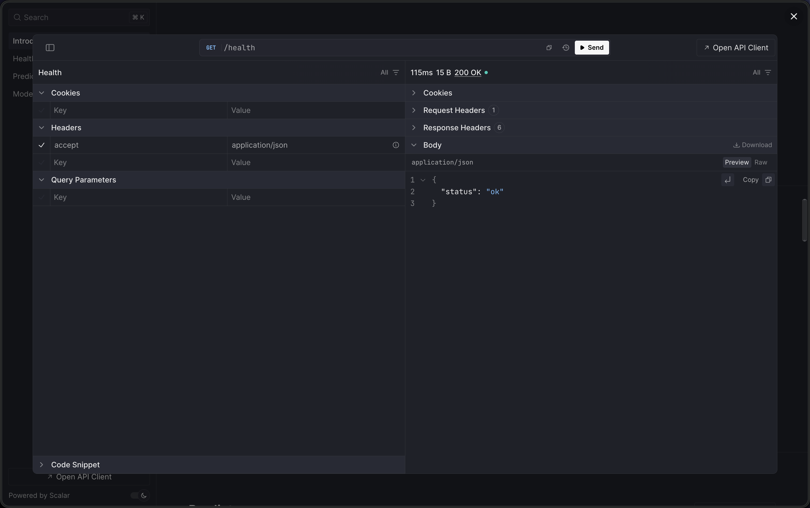
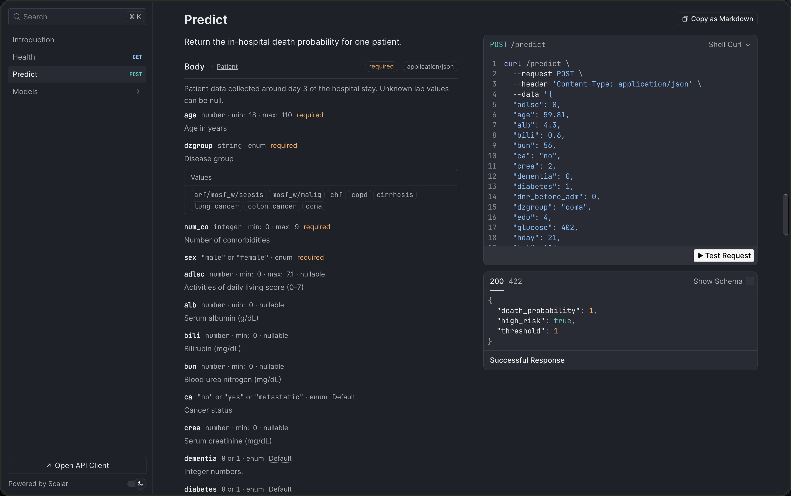
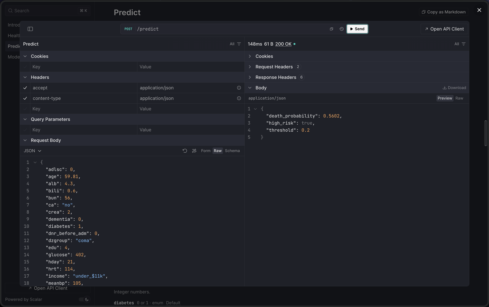
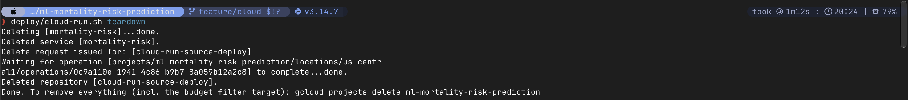

# Cloud deployment: Google Cloud Run

This guide covers deploying the mortality-risk prediction service to **Google Cloud Run**, testing it, and removing it again, at **no cost**. Everything is done with one script, [`cloud-run.sh`](cloud-run.sh), plus the project's [`Dockerfile`](../Dockerfile).

| | |
|---|---|
| Platform | Google Cloud Run (managed containers, scale to zero) |
| Region | `us-central1` |
| Service URL (while deployed) | `https://mortality-risk-439308398066.us-central1.run.app` |
| Status | Deployed and tested on 2026-11-15, then **torn down** to avoid costs |
| Cost | **$0**: everything stayed within the free tier |

---

## How it works

```
your laptop                     Google Cloud
───────────                     ────────────────────────────────────────────────────────
deploy/cloud-run.sh deploy ──►  Cloud Build ──► builds the Dockerfile:
  (uploads the source:            1. installs the locked dependencies (uv)
   .gcloudignore decides          2. trains the model  -> models/model.bin
   which files)                   3. stores the image  -> Artifact Registry (186 MB)
                                         │
                                         ▼
                                Cloud Run ──► https://mortality-risk-…run.app
                                  /health  /predict  /docs (Scalar)
```

- **No Docker on the laptop needed.** Cloud Build builds the image on Google's linux/amd64 machines, so there is no cross-compiling from an Apple-silicon Mac.
- **No code changes needed.** `serve.py` already reads the `PORT` environment variable that Cloud Run sets, and listens on `0.0.0.0`.
- **The model is trained during the build** from the committed `data/support2.csv`. Cloud Build reproduced the local scores (test PR-AUC 0.624, ROC AUC 0.813).

## Cost

Cloud Run scales to **zero instances** when idle, so it only costs anything while handling a request. For a demo, usage stays inside the [free tier](https://docs.cloud.google.com/free/docs/free-cloud-features):

| Service | Used for | Free per month | Used here |
|---|---|---|---|
| Cloud Run | serving the API | 2M requests, 180,000 vCPU-s, 360,000 GiB-s | a few dozen requests |
| Cloud Build | building the image | 2,500 build-minutes | 2 builds of ~4 min |
| Artifact Registry | storing the image | 0.5 GB | 186 MB |
| Cloud Storage | uploaded source archive | 5 GB | 1.7 MB |

Guardrails set by the script:
- `--min-instances 0`: scale to zero.
- `--max-instances 1`: at most one instance runs at a time.
- A **budget alert** emails you at 50% and 100% of the amount you set.
- `teardown` deletes every resource the deployment created.

---

## Step by step

### 0. Prerequisites
- A Google account with a **billing account that is open**. The free tier still requires one.
- [Homebrew](https://brew.sh) (macOS) or another way to install the gcloud CLI.

### 1. Install and initialize the gcloud CLI
```bash
brew install --cask gcloud-cli     # or the official installer: https://docs.cloud.google.com/sdk/docs/install-sdk
gcloud init                        # browser login, then create/pick the project
```
> `gcloud init` may print *"Compute Engine API has not been used in project … SERVICE_DISABLED"*. **This is harmless.** It only means no default Compute zone was set, and Cloud Run doesn't need one.

### 2. Link billing to the project
```bash
gcloud billing accounts list       # OPEN must be True
gcloud billing projects link <PROJECT_ID> --billing-account=<ACCOUNT_ID>
```
> **Prepayment:** in some countries a new free trial shows *"Tu prueba gratuita requiere un prepago"* ("your free trial requires a prepayment"). The billing account stays `OPEN = False` until a one-time prepayment is made. That money is a balance on the account and is refunded if unused when the account is closed ([docs](https://docs.cloud.google.com/billing/docs/how-to/payment-methods#prepayment_requirements)). Crediting can take up to 24 h.

### 3. Avoid `429 RESOURCE_EXHAUSTED` errors
By default gcloud bills API calls to a **project shared by all gcloud users** (`project_number:32555940559`), whose per-minute quota is often exhausted. Use your own project instead:
```bash
gcloud services enable cloudbilling.googleapis.com --project <PROJECT_ID>
gcloud config set billing/quota_project <PROJECT_ID>
```

### 4. One-time setup
```bash
BUDGET=20MXN deploy/cloud-run.sh setup     # use your billing account's currency, e.g. 1USD
```
This command:
- enables the APIs: Cloud Run, Cloud Build, Artifact Registry, Compute, Billing Budgets, Resource Manager, Cloud Billing, Storage
- grants `roles/run.builder` to the build service account, as the [deploy-from-source docs](https://docs.cloud.google.com/run/docs/deploying-source-code) require
- creates the budget alert

> The budget must use the **billing account's currency**. `1USD` on an MXN account fails with `INVALID_ARGUMENT`.



### 5. Deploy
```bash
deploy/cloud-run.sh deploy
```
The deploy uploads the source, builds the `Dockerfile` on Cloud Build (~4 min, including model training), and deploys the image. It ends with:
```
Service [mortality-risk] revision [mortality-risk-00001-fqq] has been deployed and is serving 100 percent of traffic.
Service URL: https://mortality-risk-439308398066.us-central1.run.app
```
The script passes `--quiet`. Without it, the first deploy waits on a *"create Artifact Registry repository?"* prompt.

### 6. Test

**From the terminal** (`curl` against the live URL, plus `deploy/cloud-run.sh test`):
```bash
curl https://mortality-risk-439308398066.us-central1.run.app/health
# {"status":"ok"}

curl -X POST -H "Content-Type: application/json" \
     -d '{"age": 59.81, "sex": "male", "dzgroup": "coma", "num_co": 3, "edu": 4,
          "income": "under_$11k", "scoma": 26, "race": "hispanic", "hday": 21,
          "diabetes": 1, "dementia": 0, "ca": "no", "dnr_before_adm": 0,
          "meanbp": 105, "wblc": 20.1, "hrt": 114, "resp": 12, "temp": 40.59,
          "pafi": 415, "alb": 4.3, "bili": 0.6, "crea": 2.0, "sod": 147, "ph": 7.64,
          "glucose": 402, "bun": 56, "urine": 1350, "adlsc": 0}' \
     https://mortality-risk-439308398066.us-central1.run.app/predict
# {"death_probability":0.5602,"high_risk":true,"threshold":0.2}

curl -X POST -H "Content-Type: application/json" \
     -d '{"age": 45, "sex": "female", "dzgroup": "chf", "num_co": 1}' \
     https://mortality-risk-439308398066.us-central1.run.app/predict
# {"death_probability":0.0151,"high_risk":false,"threshold":0.2}
```


The cloud prediction for the example patient (**0.5602**, high risk) is identical to the local one, because it is the same model and the same feature code.

**From the browser:** open the Scalar API reference at `<URL>/docs`.



`GET /health` through Scalar's *Test Request*: **200 OK** in 115 ms.



The `POST /predict` documentation, generated from the Pydantic model (required fields, enums, ranges):



`POST /predict` with the example patient: **200 OK** in 148 ms, `death_probability = 0.5602`.



> **Cold start:** the first request after the service has been idle takes a few seconds while an instance starts and loads pandas, scikit-learn and xgboost. The requests after that take ~100–150 ms.

### 7. Teardown (avoid costs)
```bash
deploy/cloud-run.sh teardown
```
Teardown deletes:
- the Cloud Run service
- the Artifact Registry repository `cloud-run-source-deploy`, with all its images
- the bucket of uploaded source archives



Check that nothing is left:
```bash
gcloud run services list --region us-central1             # Listed 0 items.
gcloud artifacts repositories list --location us-central1 # Listed 0 items.
gcloud storage ls                                         # no buckets
```
To remove everything, including the project itself and its budget, run `gcloud projects delete <PROJECT_ID>`. Then confirm the cost under *Billing → Reports* in the console.

> If you interrupt a deploy with Ctrl+C, the build keeps running on Cloud Build. Run `teardown` afterwards anyway.

---

## Script reference

| Command | What it does |
|---|---|
| `deploy/cloud-run.sh setup` | Enable the APIs, IAM role for the build, budget alert (`BUDGET=…`) |
| `deploy/cloud-run.sh deploy` | Build the Dockerfile on Cloud Build and deploy to Cloud Run |
| `deploy/cloud-run.sh test` | `GET /health` and `POST /predict` on the live URL |
| `deploy/cloud-run.sh teardown` | Delete the service, the images and the source bucket |

Settings come from env vars:
- `PROJECT_ID`: defaults to the current gcloud project
- `REGION`: `us-central1`
- `SERVICE`: `mortality-risk`
- `BUDGET`: `1USD`

Other useful commands:
```bash
gcloud run services list --region us-central1
gcloud builds list --region us-central1 --limit 3                 # recent builds (check here if a deploy fails)
gcloud run services logs read mortality-risk --region us-central1 --limit 20
```
